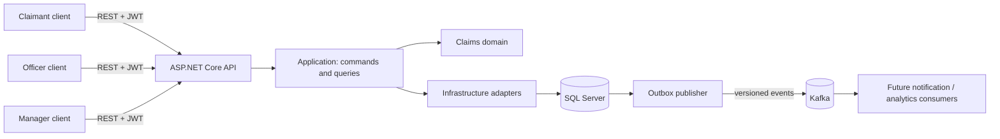

# Chubb APAC Claims Backend
## Architecture and SQL Server Data Model

### 1. Purpose and scope

This design supports the backend workflows in the brief for motor and property claims in six APAC markets:

- Claimants submit an incident, retrieve the current claim state, answer information requests, and see a decision.
- Claims officers find work, take or receive assignments, review evidence, record assessments, request information, and move claims to an outcome.
- Managers read current workload, progress, basic performance, and outstanding reserve exposure.

The deliverable is a backend only. Payment execution, document binary storage, customer identity proofing, policy administration, coverage adjudication rules, FX conversion, and market-specific regulatory rules are outside the initial build. The design records enough references and facts to integrate these capabilities later without pretending to implement them.

### 2. Recommended architecture

Use a **.NET 10 / ASP.NET Core 10 modular monolith** with one deployable API and one SQL Server database. Keep module and project boundaries clear, but avoid microservices: the assessed workflows are one cohesive claims lifecycle, and atomic claim plus outbox persistence is simplest and safest in one service/database.



Suggested solution layout:

```text
src/
  Chubb.Claims.Domain/          # Entities, value objects, lifecycle rules, domain events
  Chubb.Claims.Application/     # Commands, queries, handlers, DTOs, ports, validation
  Chubb.Claims.Infrastructure/  # EF Core, SQL Server, repositories, outbox, Kafka publisher
  Chubb.Claims.Api/             # REST endpoints, auth, composition root, OpenAPI
tests/
  Chubb.Claims.Domain.Tests/
  Chubb.Claims.Application.Tests/
  Chubb.Claims.Api.Tests/
```

The API is the only process that owns claim writes. `Claims` is the write model. CQRS means commands and queries have separate use cases and contracts; it does **not** require event sourcing, a second database, or a broker for ordinary reads. Manager projections can start as indexed SQL queries over the same database.

### 3. Boundaries and ownership

| Area | Owns | Must not own |
|---|---|---|
| Domain | Claim lifecycle, valid transitions, assessment/decision/reserve invariants | ASP.NET, EF Core, SQL, JWT, Kafka |
| Application | Submit/request/assign/assess/decide/settle commands; claimant/staff/manager queries; authorization context and persistence/outbox ports | HTTP types, EF entities, Kafka client types |
| Infrastructure | SQL Server mappings and transactions, query implementations, outbox leasing/retries, Kafka transport | Business transition rules or API authorization policy definitions |
| API | REST DTOs, validation boundary, JWT validation, role policies, error mapping, OpenAPI | Direct database access, direct Kafka publishing, claim business rules |
| Reporting queries | Read-only workload, ageing, outcomes, reserve aggregates | Claim mutation or a competing source of financial truth |

Use the external identity provider's stable subject identifier as the principal key. Store no passwords. Resolve a claimant's permitted records by comparing the authenticated `sub` claim to `Claims.ClaimantSubjectId`; do not accept a claimant subject from request input as authority. Staff roles come from signed identity claims/policies. The database contains staff display/team membership metadata, not credentials.

### 4. Communication choices

**REST/HTTP is synchronous** when the caller needs an immediate result or an authorization/validation decision: submit a claim, fetch a claim, list an officer queue, respond to a request, assign work, record an assessment/decision, or read a manager dashboard. Use resource-oriented endpoints, stable IDs, paging, explicit status codes, and version/concurrency handling.

**Kafka is asynchronous** for integration notifications after a committed business change, such as `ClaimSubmitted`, `ClaimAssigned`, `ClaimInformationRequested`, `ClaimStatusChanged`, and `ClaimDecisionRecorded`. Consumers may send notifications, feed a warehouse, or synchronize another platform without slowing or breaking the claim API. Kafka is not used for a claimant's immediate GET, for commands that need validation feedback, or as a substitute for the claim database.

Use a **SQL Server transactional outbox**: persist the claim mutation, activity/audit row, and serialized outbox event in the same SQL transaction. A background publisher claims pending rows, publishes an envelope with a stable `EventId`, and marks it published only after broker acknowledgement. Retry transient failures with backoff and record attempt/error metadata. This is at-least-once delivery: a crash after Kafka accepts an event but before SQL marks it published can cause a duplicate, so consumers deduplicate by `EventId`. Do not claim exactly-once delivery or use a distributed SQL/Kafka transaction.

Keep the event set small and versioned. Events describe facts that have already happened and carry identifiers, market, timestamp, and minimal non-sensitive data. Do not include claimant contact details, incident narratives, or document contents in Kafka payloads; consumers can call authorized APIs or use a separately governed integration if they need sensitive data.

### 5. Lifecycle and business invariants

Use an explicit state machine, enforced in the Domain layer and rechecked under optimistic concurrency in the persistence layer. A reasonable initial status set is:

```text
Submitted -> InReview -> Assessment
                  |           | \
                  v           v  v
          AwaitingInformation  Approved / Rejected
                  |
                  +----------> InReview
Approved -> Settled
```

Rules for the first implementation:

- A new claim starts `Submitted`; only an authorized claims officer can take it into review.
- An officer can request additional information during review/assessment. An active request moves the claim to `AwaitingInformation`.
- The claimant can respond only to an open request on a claim they own. When all active requests have a response, a staff action resumes review; claimant input does not decide the claim.
- Assessment is an auditable staff action. Assessment may update an explicitly labelled reserve estimate, recommendation, and rationale; it does not invent coverage rules.
- A final decision is either approved or rejected and is recorded with actor, timestamp, reason, and optional decision amount/currency where the business has supplied one. Do not infer a covered amount from the incident facts.
- A rejected claim is closed. An approved claim may progress to `Settled` through a recorded settlement-completion action. This records workflow completion only; it does not transfer money.
- Do not add reopen, withdrawal, appeal, SLA, or automatic acceptance rules without an explicit business requirement.
- Use SQL `rowversion` (or an equivalent concurrency token) so two officers cannot silently overwrite an assignment, status, or reserve update.

### 6. SQL Server schema overview

Use `dbo` or an explicit `claims` schema consistently. The tables below are a complete first-pass relational model for the requested workflows. Prefer `uniqueidentifier` primary keys generated by the service, UTC `datetime2`/`datetimeoffset` timestamps, `decimal(19,4)` monetary values, `nvarchar` for human text, and explicit FK/check constraints. Store currency alongside every amount. Do not sum different currencies into one exposure figure without a governed FX rate source.

#### Reference and identity metadata

| Table | Purpose and key columns | Constraints / useful indexes |
|---|---|---|
| `Markets` | `MarketCode char(3) PK`, `Name nvarchar(100)`, `DefaultCurrency char(3)`, `TimeZoneId nvarchar(100)`, `IsActive bit` | Seed the six agreed market codes only after confirming them; do not invent market-specific rules. |
| `ClaimantProfiles` | `SubjectId nvarchar(200) PK`, `DisplayName nvarchar(200)`, `Email nvarchar(320)`, `Phone nvarchar(50)`, `CreatedUtc`, `UpdatedUtc` | Subject is supplied by trusted identity. PII access must be restricted and retained only as needed. Claim records keep submission-time contact snapshots. |
| `StaffProfiles` | `SubjectId nvarchar(200) PK`, `DisplayName nvarchar(200)`, `IsActive bit`, `CreatedUtc`, `UpdatedUtc` | No password or token columns. Identity provider remains authoritative for authentication/roles. |
| `Teams` | `TeamId uniqueidentifier PK`, `TeamCode nvarchar(50) UNIQUE`, `Name nvarchar(200)`, `IsActive bit` | Team can serve one or more markets through `TeamMarkets`. |
| `TeamMarkets` | `TeamId FK`, `MarketCode FK`, composite PK | Supports teams across supported markets without hardcoding one team per market. |
| `TeamMemberships` | `TeamId FK`, `StaffSubjectId FK`, `EffectiveFromUtc`, `EffectiveToUtc NULL`, `AddedBySubjectId` | Composite/effective-date uniqueness; index active memberships by staff and team. Authorization still comes from JWT policy, not membership alone. |

#### Claim write model and line-specific facts

| Table | Purpose and key columns | Constraints / useful indexes |
|---|---|---|
| `Claims` | `ClaimId uniqueidentifier PK`; `ClaimNumber nvarchar(32) UNIQUE`; `ClaimantSubjectId FK`; submission-time `ClaimantName`, `ClaimantEmail`, `ClaimantPhone`; `MarketCode FK`; `LineOfBusiness` (`Motor`/`Property`); `PolicyNumber nvarchar(100) NULL`; `IncidentOccurredUtc datetimeoffset`; `ReportedUtc`; `Description nvarchar(4000)`; `Status`; `CurrentReserveAmount decimal(19,4) NULL`; `CurrentReserveCurrency char(3) NULL`; `SubmittedUtc`; `CreatedUtc`; `UpdatedUtc`; `ClosedUtc NULL`; `RowVersion rowversion` | Check constraints for line/status and reserve amount/currency nullability. Index `(ClaimantSubjectId, CreatedUtc DESC)` for claimant history; `(MarketCode, Status, SubmittedUtc)` for queues; `(Status, UpdatedUtc)` for ageing; claim number unique. Keep reserve current value as a query-friendly projection, updated in same transaction as reserve history. |
| `MotorClaimDetails` | `ClaimId PK/FK`; `VehicleRegistration nvarchar(40) NULL`; `Make nvarchar(100) NULL`; `Model nvarchar(100) NULL`; `ModelYear smallint NULL`; `VehicleUse nvarchar(80) NULL`; `Drivable bit NULL`; `OtherPartyInvolved bit NULL`; optional incident/location details | One-to-one with a Motor claim; validate `ModelYear` range if provided. Do not put non-motor data into generic columns. |
| `PropertyClaimDetails` | `ClaimId PK/FK`; `PropertyType nvarchar(80) NULL`; `RiskAddressLine1/2`, `City`, `Region`, `PostalCode`, `CountryCode`; `LossCause nvarchar(120) NULL`; `AffectedAreaDescription nvarchar(2000) NULL`; `Habitable bit NULL` | One-to-one with a Property claim. Avoid claiming `LossCause` is a coverage determination. |

Create exactly one matching line-detail row when required by the API; enforce the one-to-one FK and validate the line/detail pairing in the application transaction. If later lines need materially different facts, add a separate detail table rather than a wide table with many unrelated nullable columns.

#### Workflow, evidence, and audit

| Table | Purpose and key columns | Constraints / useful indexes |
|---|---|---|
| `ClaimAssignments` | `AssignmentId PK`; `ClaimId FK`; `TeamId FK`; `OfficerSubjectId FK NULL` (unassigned team queue supported); `AssignedBySubjectId`; `AssignedUtc`; `UnassignedUtc NULL`; `Reason nvarchar(500) NULL` | History of assignment changes. Filtered unique index on `ClaimId WHERE UnassignedUtc IS NULL` for one current assignment. Index `(TeamId, UnassignedUtc, AssignedUtc)` and `(OfficerSubjectId, UnassignedUtc, AssignedUtc)` for workload. |
| `ClaimInformationRequests` | `RequestId PK`; `ClaimId FK`; `RequestedBySubjectId`; `Question nvarchar(2000)`; `RequestedUtc`; `DueUtc NULL` (optional informational date; no SLA implied); `Status` (`Open`, `Responded`, `Cancelled`); `ResolvedUtc NULL` | Index `(ClaimId, Status, RequestedUtc)`; permit several request rounds per claim. |
| `ClaimInformationResponses` | `ResponseId PK`; `RequestId FK`; `SubmittedBySubjectId`; `ResponseText nvarchar(4000) NULL`; `SubmittedUtc` | Responses append; allow multiple uploads. Claim ownership and open-request checks happen in the command handler/domain. |
| `ClaimDocuments` | `DocumentId PK`; `ClaimId FK`; `ResponseId FK NULL`; `UploadedBySubjectId`; `Audience` (`Claimant`, `Staff`); `StorageProvider`; `ObjectKey nvarchar(500)`; `OriginalFileName nvarchar(255)`; `ContentType nvarchar(150)`; `LengthBytes bigint`; `Sha256 char(64)`; `UploadStatus`; `UploadedUtc`; `DeletedUtc NULL` | Store metadata only; binary lives in protected object storage. Never expose `ObjectKey` publicly. Validate size/type/scan before staff use. Index by `(ClaimId, UploadedUtc)`. |
| `ClaimAssessments` | `AssessmentId PK`; `ClaimId FK`; `AssessorSubjectId`; `AssessmentType`; `Recommendation nvarchar(40) NULL`; `Rationale nvarchar(4000)`; `CreatedUtc` | Append-only history. Recommendation is not an automatic decision or coverage rule. Index `(ClaimId, CreatedUtc DESC)`. |
| `ClaimReserveHistory` | `ReserveEntryId PK`; `ClaimId FK`; `Amount decimal(19,4)`; `Currency char(3)`; `EstimateType nvarchar(40)`; `Reason nvarchar(1000)`; `RecordedBySubjectId`; `RecordedUtc` | Append-only audit of estimates. The current `Claims` reserve projection and history row update atomically. Not an accounting ledger or a booked liability. Index `(ClaimId, RecordedUtc DESC)`. |
| `ClaimDecisions` | `DecisionId PK`; `ClaimId FK UNIQUE`; `DecisionType` (`Approved`, `Rejected`); `Reason nvarchar(4000)`; `DecisionAmount decimal(19,4) NULL`; `DecisionCurrency char(3) NULL`; `DecidedBySubjectId`; `DecidedUtc` | One final decision per initial lifecycle. Check amount/currency pair. Keep rationale staff-only unless product/legal review approves claimant-facing wording. Claimant API returns only approved-for-claimant decision fields. |
| `ClaimSettlements` | `SettlementId PK`; `ClaimId FK UNIQUE`; `Status` (`Pending`, `Completed`); `Amount decimal(19,4) NULL`; `Currency char(3) NULL`; `RecordedBySubjectId`; `CreatedUtc`; `CompletedUtc NULL`; `Reference nvarchar(100) NULL` | Workflow record only, not payment execution. Only create after an approved decision; amount is not automatically copied unless explicitly supplied. |
| `ClaimActivities` | `ActivityId PK`; `ClaimId FK`; `ActivityType`; `ActorSubjectId NULL`; `ActorKind`; `Visibility` (`Claimant`, `Staff`, `System`); `Summary nvarchar(1000)`; `OccurredUtc`; optional `CorrelationId` | Append-only timeline/audit events. Never place secrets or full sensitive narratives in a public summary. Index `(ClaimId, OccurredUtc DESC)` and `(ActivityType, OccurredUtc)`. |
| `ClaimNotes` | `NoteId PK`; `ClaimId FK`; `AuthorSubjectId`; `NoteText nvarchar(4000)`; `CreatedUtc`; `EditedUtc NULL`; `DeletedUtc NULL` | Internal only; never included in claimant DTOs. Record edit/deletion according to audit policy or make immutable if audit requirements demand it. |

#### Integration reliability and request safety

| Table | Purpose and key columns | Constraints / useful indexes |
|---|---|---|
| `OutboxMessages` | `EventId uniqueidentifier PK`; `AggregateType`; `AggregateId`; `EventType`; `EventVersion smallint`; `OccurredUtc`; `Payload nvarchar(max)`; `CreatedUtc`; `PublishedUtc NULL`; `AttemptCount int`; `NextAttemptUtc`; `LastError nvarchar(2000) NULL`; `LockId uniqueidentifier NULL`; `LockedUntilUtc NULL` | Index pending rows by `(PublishedUtc, NextAttemptUtc, CreatedUtc)`; use short leases/locking to avoid concurrent publishers. Payload contains minimal non-sensitive data. |
| `IdempotencyRecords` (recommended for submission) | `IdempotencyKey nvarchar(200)`; `ActorSubjectId`; `Operation`; `RequestHash char(64)`; `ResponseStatus`; `ResponseBody nvarchar(max)`; `CreatedUtc`; `ExpiresUtc`; composite PK `(ActorSubjectId, Operation, IdempotencyKey)` | Prevent accidental duplicate submissions after client retries. Reject reuse of a key with a different request hash. Define a retention period before implementation. |

#### Relational and operational rules

- Use FKs with restrictive deletes for claims, decisions, activities, assessments, evidence metadata, and outbox. Avoid cascading deletion of regulated or auditable records.
- Add check constraints for enum values, non-negative reserve/settlement amounts, valid status values, and paired amount/currency fields. Keep domain validations in the application too so errors are readable.
- Add indexes based on the real queue filters: market, status, assignment team/officer, submitted date, incident date, and claimant subject. Use deterministic keyset paging for large lists; never return an unbounded queue.
- `rowversion` is returned as an ETag/concurrency token for staff mutation endpoints. A stale write returns `409 Conflict` (or `412 Precondition Failed` with `If-Match`) and asks the client to reload.
- Use UTC for persisted timestamps. Preserve the incident's supplied offset/time zone where it matters; the market timezone is presentation/reference metadata, not a substitute for the incident offset.
- Minimize PII in logs, activities, and Kafka. Define document malware scanning, access auditing, encryption, retention, and deletion policy before production use.
- The six market codes, default currencies, identity provider, retention periods, policy integration, and local market rules are deployment/business inputs; do not fabricate them.

### 7. CQRS use-case map

**Commands** (validate caller, load only required aggregates, invoke domain behavior, save claim/activity/outbox atomically):

1. `SubmitClaim` — claimant; creates claim and matching detail row, initial activity, optional idempotency record, `ClaimSubmitted` event.
2. `AssignClaim` / `ReassignClaim` — officer or manager policy; closes prior assignment and opens current one; `ClaimAssigned` event.
3. `StartReview` / `RecordAssessment` — claims officer; changes status and optionally records assessment/reserve.
4. `RequestInformation` — staff; creates request, changes status, public-safe activity, `ClaimInformationRequested` event.
5. `SubmitInformationResponse` — owning claimant; appends response and document metadata; emits event without sensitive content.
6. `ResumeReview` — staff; checks outstanding request state and returns the claim to review.
7. `RecordDecision` — authorized officer; persists one final decision, activity, and `ClaimDecisionRecorded` event; moves to `Approved` or `Rejected`.
8. `CompleteSettlement` — authorized officer; records workflow completion on an approved claim and moves to `Settled`.
9. `AddInternalNote` and `UpdateReserveEstimate` — staff; append audit/history and update the current reserve projection.

**Queries** (return purpose-built DTO projections and never mutate claims):

1. `GetClaimForClaimant` — requires claim ID and token subject ownership; returns safe status, submitted facts, open information requests, claimant-visible activities, and claimant-safe decision.
2. `ListClaimantClaims` — own claims only, paginated.
3. `GetClaimForStaff` — authorized staff; includes assignment, staff-only notes, assessments, reserve history, documents, and activity.
4. `ListWorkQueue` — filters by market, team, officer, status, age range, and text/claim number; stable paging and sort.
5. `GetTeamWorkload` — counts by status/assignee/market and ageing buckets explicitly defined as elapsed-day bands, not contractual SLA.
6. `GetTeamPerformance` — counts decisions/settlements in a selected period and elapsed processing time where timestamps are available; distinguish current workload from work completed in-period.
7. `GetOutstandingExposure` — sums current reserve estimates for in-scope open claims and groups by currency and market. State included statuses, exclusions, missing-reserve count, and that this is a demo estimate, not booked/regulatory liability. Do not FX-convert without a rate source.

### 8. REST API outline

Use `/api/v1` and JSON DTOs rather than serializing EF/domain entities.

| Method / route | Policy | Purpose |
|---|---|---|
| `POST /api/v1/claims` | Claimant | Submit a motor or property claim; accept `Idempotency-Key`; return `201` and claim number/location. |
| `GET /api/v1/claims` | Claimant | List only the caller's claims. |
| `GET /api/v1/claims/{claimId}` | Claimant or staff | Claimant ownership enforced; staff sees a staff projection. |
| `POST /api/v1/claims/{claimId}/information-requests/{requestId}/responses` | Claimant | Respond to an open request on an owned claim. |
| `GET /api/v1/claims/{claimId}/timeline` | Claimant or staff | Visibility-filtered activities. |
| `GET /api/v1/staff/claims` | ClaimsOfficer / Manager | Search and page the staff queue. |
| `POST /api/v1/staff/claims/{claimId}/assignment` | ClaimsOfficer / Manager | Assign/reassign to a team/officer. |
| `POST /api/v1/staff/claims/{claimId}/review` | ClaimsOfficer | Begin review. |
| `POST /api/v1/staff/claims/{claimId}/information-requests` | ClaimsOfficer | Request specific evidence/information. |
| `POST /api/v1/staff/claims/{claimId}/assessments` | ClaimsOfficer | Add assessment and optional reserve estimate. |
| `POST /api/v1/staff/claims/{claimId}/decision` | ClaimsOfficer | Record approved/rejected decision. |
| `POST /api/v1/staff/claims/{claimId}/settlement-completion` | ClaimsOfficer | Record workflow settlement completion. |
| `POST /api/v1/staff/claims/{claimId}/notes` | ClaimsOfficer | Add internal note. |
| `GET /api/v1/manager/workload` | Manager | Read-only workload/performance summary. |
| `GET /api/v1/manager/exposure` | Manager | Read-only reserve exposure by market/currency/status. |

Apply role policies and resource ownership checks on every route, including nested routes. Validate and normalize market/line/status enums, reject unexpected fields, cap page size, and return `400` validation problems, `401/403` auth errors, `404` for unavailable resources, `409` lifecycle/concurrency conflicts, and `201/200` for successful mutations/reads. Use Problem Details for errors.

### 9. Manager reporting definitions

To keep the dashboard explainable:

- **Workload** is the count of currently non-closed claims grouped by status, market, team, and assigned officer. Claims without an active assignment appear in an unassigned group.
- **Ageing** is elapsed UTC days from submission (or from the latest status entry if a later-status duration is shown); use named bands configurable at deployment and label them as reporting bands, not SLAs.
- **Performance** is completed decision count and median/average elapsed days from submission to decision, plus settlement completion count/time when present. Show the date range and exclude missing timestamps from duration averages while showing their count.
- **Outstanding exposure** is the sum of the latest reserve estimate for explicitly included non-closed statuses, grouped by market and currency. Include claims missing reserve separately. The business must approve the included status list. Never add mixed currencies or call the estimate booked liability.

### 10. Security and production boundaries

- Validate JWT issuer, audience, signature, lifetime, and role/subject claims. Configure signing keys and secrets outside the repository.
- Do not ship a development token issuer in non-Development environments.
- Authorize by role **and** claim resource ownership/team scope. A role alone is not permission to access arbitrary claimant data.
- Avoid PII in event payloads and routine application logs. Restrict internal notes and decision rationale to staff-facing queries.
- Store document bytes in protected object storage; the SQL table contains metadata and opaque object keys only. Require malware scanning and short-lived authorized download links before production.
- Use TLS, SQL least-privilege credentials, encryption at rest, secret management, audit retention, backups, and operational alerting according to Chubb standards.

### 11. Explicit assumptions and questions for business validation

This assessment implementation can proceed with clearly labelled demo assumptions, but these need owner decisions before production: the six market codes/currencies/time zones; claim number format; identity provider and subject claim; which roles may assign or decide; required motor/property fields; document storage and limits; reserve estimate authority; exposure status inclusion; decision disclosure; retention/privacy rules; settlement completion authority; and event consumers/topics. Do not embed assumptions as if they were Chubb policy.

